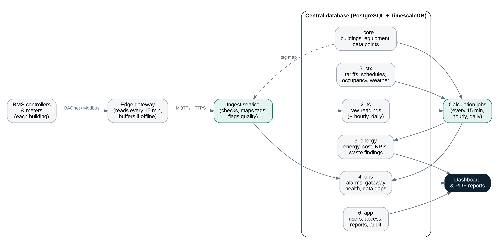

# BEACON

**Building Energy Analytics, Control & Optimisation Network**

Edge-to-cloud BMS platform for real-time energy monitoring, KPI computation, waste detection and fault tracking across multi-building portfolios, with PDF reporting for management. Supervised control of setpoints and schedules is planned for phase 2.

> This repository is the idea presentation: an interactive demo with **simulated data** and the design documents. It does not connect to a real BMS.

## Repository contents

| Path | Description |
|---|---|
| `dashboard/` | Interactive demo website: plain HTML, CSS and JavaScript, no build step |
| `docs/BMS_Data_Requirements.docx` | Data required from each building system, with KPIs |
| `docs/Database_Design.docx` | Database design (PostgreSQL + TimescaleDB), on paper |
| `docs/diagrams/` | Data flow and table relationship diagrams |
| `docs/Sample_Portfolio_Report.pdf` | Example PDF report produced by the dashboard |

## Run the demo

1. Open `dashboard/index.html` in Chrome or Edge (double-click it). Nothing to install.
2. Pick a demo role, or sign in with `manager`, `hotel` or `operator` and password `demo`.

Charts (ECharts), fonts and PDF reports (pdf-lib) load from public CDNs, so an internet connection is needed. The login is for demonstration only and is not real security.

## Demo features

- Three demo buildings (office, hotel, mall), readings every 15 simulated minutes from a simulated edge gateway, including store-and-forward after a gateway outage
- **Raw data / KPI view** switch: the same readings as the BMS stores them, or turned into KPIs and insights
- Pages: Portfolio Overview, Building View, System Detail, Faults & Alerts, Energy Insights, Reports
- Roles: Portfolio Manager (all buildings), Building Manager (one building), Control Room Operator
- PDF reports: Portfolio, Building, System or Comparison; today, yesterday or last 7 days; company header and standard tables
- Light and dark theme

To put your company name and logo on reports, edit `DEMO.COMPANY` in `dashboard/js/data.js`.

## Architecture (planned)

| Layer | Technology |
|---|---|
| Edge gateway (per building) | Industrial PC reading BACnet / Modbus, buffering when offline |
| Transport | MQTT or HTTPS over TLS |
| Storage | PostgreSQL with TimescaleDB (time-series readings, compression, continuous aggregates) |
| Processing | Scheduled jobs: energy by system, cost by tariff band, KPIs, waste rules, data gaps |
| Presentation | Web dashboard and PDF reports |

## Roadmap

- **Phase 1:** Monitoring and analytics (this demo and the designs)
- **Phase 2:** Supervised control: setpoint and schedule changes with limits, approvals and audit trail
- **Later:** Maintenance data, 3D building view

## License

Copyright (c) 2026 GKartheeban. All rights reserved. See [LICENSE](LICENSE).
